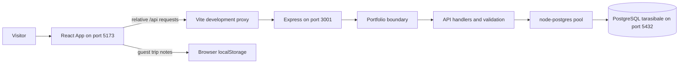

# Architecture

The browser renders the interface; Express decides which requests are allowed;
PostgreSQL stores shared catalog records and account-owned data. The browser
never connects directly to PostgreSQL.

The proxy is a development arrangement. A production host would need its own
static-file hosting and `/api` routing; this diagram does not describe an
already deployed production service.

## A page load, step by step

1. `main.tsx` mounts React. `App.tsx` chooses the current tab from the URL hash
   or saved preference and starts with empty catalog collections.
2. `refreshCatalog` requests `/api/catalog` and `/api/reviews`. Separately,
   `/api/auth/me` determines whether a session belongs to a user.
3. The API reads non-archived entries from five catalog tables, permissions from `settings`, and
   review aggregates. It groups entries into attractions, stays, ferries,
   culture, and trails.
4. In portfolio mode, the server transforms the outgoing catalog for the demo.
   Stored records remain intact. Public reviews are returned as an empty list.
5. React stores the response and passes collections to display components.
   Larger screens such as Culture and Map load lazily when needed.

If an account is active in full application mode, `/api/bootstrap` additionally
loads its saved state, bookings, and group messages. It is a different request
from the public catalog. See [[TaraSibale - Saved State]].

## Responsibilities

| Layer | Responsibility | Entry point |
| --- | --- | --- |
| React shell | Navigation, shared collections, user identity, loading/error state | `Frontend/src/App.tsx` |
| Display components | Filtering, cards, dialogs, feature-specific interaction | `Frontend/src/components/` |
| Browser API helper | Cookies, JSON requests, visible error notifications | `Frontend/src/api.ts` |
| HTTP shell | Listener lifecycle, health checks, portfolio boundary | `Backend/src/server.ts`, `app.ts` |
| API | Authorization, validation, SQL transactions, responses | `Backend/src/api.ts` |
| Persistence | Connections, schema constraints, migrations, reference seeding | `Backend/src/db.ts`, `migrations/`, `scripts/` |

The API module currently contains many features in one file. The graph's large
cluster around it reflects this shared implementation, not separate services.

Continue: [[TaraSibale - Feature Flows]], [[TaraSibale - Code Map]].

Symbol references: [[App()]], [[createApp()]], [[createApi()]], [[checkDatabase()]].

Sources: [React startup](../../Frontend/src/main.tsx), [app shell](../../Frontend/src/App.tsx),
[proxy](../../Frontend/vite.config.ts), [HTTP shell](../../Backend/src/app.ts),
[API](../../Backend/src/api.ts), [pool](../../Backend/src/db.ts).
