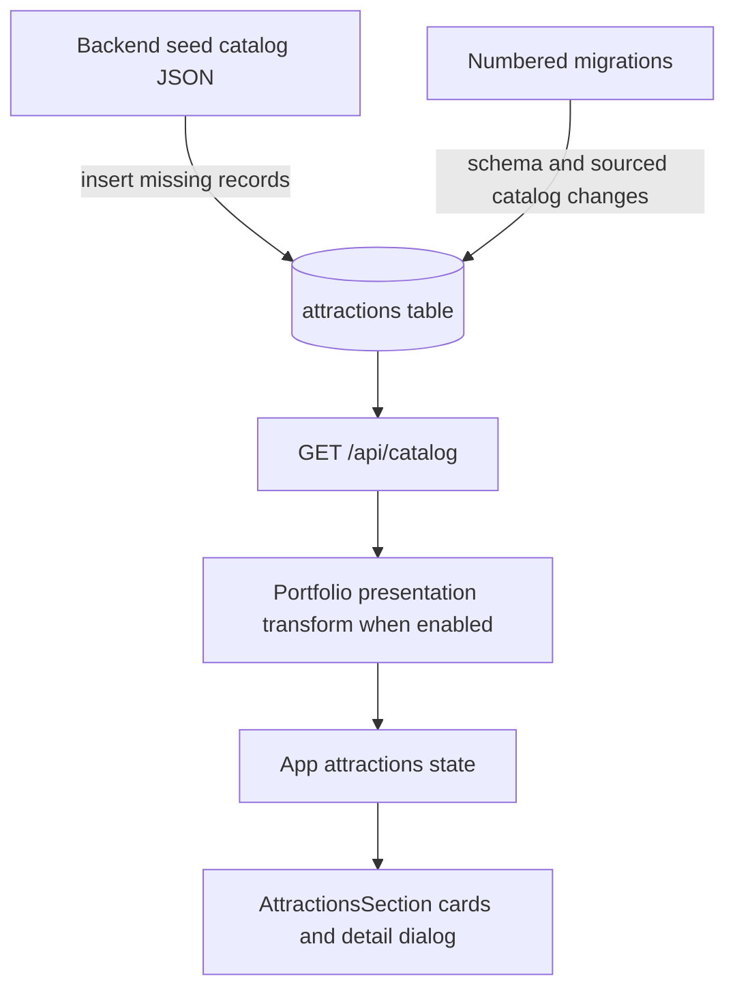

# Attractions and Data

**The displayed attractions come from the API and database, not from importing
the `ATTRACTIONS` array into the current application.** This explains why the
raw symbol note you first opened did not reveal the actual feature flow.

## What `ATTRACTIONS` represents

`Frontend/src/data/concepcionData.ts` declares a typed reference array beginning
with Guiwanon Beach. Each item holds fields such as an ID, name, description,
coordinates, highlights, source references, and photo provenance.

A repository search on the review date found the `ATTRACTIONS` declaration
but no active source import of that array. It is retained reference material.
Changing it alone will not update the catalog served by the backend.

The Culture tab groups the directory entries by barangay. The source verifies
barangay names. Dates and patron saints still need local confirmation.
[Fiesta source notes](../fiesta-sources.md)

The raw Graphify node records the declaration and its containing file. The
implementation reference below groups its reviewed explanation with the other
catalog fixtures, while this guide explains the runtime path.

## The actual display path

`App.tsx` starts with an empty attractions array. `refreshCatalog` assigns the
API result to that state. `AttractionsSection` receives it as a prop and filters
it by category and search text. Favorites in this component are kept in React
state for the current visit; that favorite toggle is not an account database write.

## Three different forms of data

| Form | Purpose | What editing it changes |
| --- | --- | --- |
| Frontend reference arrays | Typed reference content retained in source | The source file; not the active API catalog |
| `Backend/seed/catalog.json` | Input for missing reference records | Future inserts from the seed command; existing IDs are preserved |
| PostgreSQL `attractions.data` | Runtime catalog payload | What the API reads, subject to archive filtering and portfolio presentation |

The migration history also contains deliberate sourced-content updates. The
seed script uses `ON CONFLICT DO NOTHING`; rerunning it does not replace an
existing resource's edited JSON. Applied migration files are not an edit mechanism.

For an intentional change to existing catalog content, review the authenticated
admin catalog route in full application mode, or add an appropriate forward
data migration. The admin route accepts collections and can remove omitted
non-archived records; understand that behavior before using it.

## Why the screen differs from stored data

- Archived entries are excluded from the public catalog.
- Attraction and accommodation ratings/counts are derived from stored reviews.
- Portfolio presentation substitutes unapproved images and clears galleries.
- Unknown locations, fees, hours, and lodging details remain explicitly unconfirmed.
- The sourced lodging entries are reference-only. Their presence is not proof
  of bookable inventory or a verified commercial partnership.

Content citations in the project document provenance; these guides do not
re-verify those external sources or current travel conditions.

Continue: [[TaraSibale - Database]], [[TaraSibale - Modes and Access]].

Symbol references: [[ATTRACTIONS]], [[AttractionsSection()]], [[portfolioCatalog()]].

Sources: [reference array](../../Frontend/src/data/concepcionData.ts),
[loading and state](../../Frontend/src/App.tsx),
[attraction UI](../../Frontend/src/components/AttractionsSection.tsx),
[catalog handler](../../Backend/src/api.ts), [seed script](../../Backend/scripts/seed.ts),
[seed data](../../Backend/seed/catalog.json), [attraction source notes](../attraction-sources.md),
[lodging migration](../../Backend/migration-history/008_sourced_accommodations.sql).
