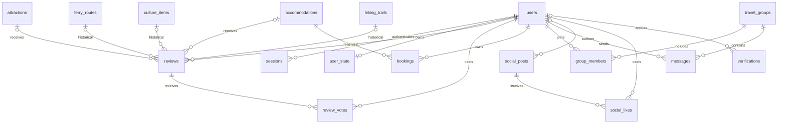

# Database

PostgreSQL stores both relational ownership and flexible display payloads.
Each catalog type has its own table with a primary key and a checked JSONB
`data` object. For example, attraction rows live in `attractions`.

The local database is `tarasibale`, owned by the existing `gemini.psql` role on
port 5432. The connection secret lives only in ignored `Backend/.env`; it is
not copied into this knowledge base.

## Relationship map

`settings` and `schema_migrations` are standalone tables and are not shown as
relationships. A user may have no `user_state` row at the schema level, though
signup creates one. Social posts and verification applications can retain a
null user reference after an account is deleted.

## What belongs where

| Table | Meaning |
| --- | --- |
| `users`, `sessions` | Account profile, password hash, role/verification; hashed session tokens and expiry |
| `attractions`, `accommodations`, `ferry_routes`, `culture_items`, `hiking_trails` | Catalog payloads with checked fields and IDs |
| `settings` | Feature permissions stored under the `permissions` key |
| `reviews`, `review_votes` | Authored reviews and one helpful vote per user/review pair |
| `bookings` | Account-owned dates, guest count, room type, total, status and response payload |
| `travel_groups`, `group_members`, `messages` | Group identity, membership, and authored chat messages |
| `social_posts`, `social_likes` | Shared post payloads and one like per account/post pair |
| `verifications` | Applications for resident, host, or guide verification |
| `user_state` | Per-account notifications, documents, itinerary, checklists and update timestamp |
| `schema_migrations` | Applied SQL filenames and timestamps |

## Why JSONB does not replace relational rules

Display content has different shapes, so JSONB avoids many optional columns.
Ownership, foreign keys, dates, status, and amounts still have relational
constraints where needed. Some values are represented in both columns and the
JSON response payload; API writes must keep these representations consistent.

Bookings link directly to an accommodation. Their capacity checks happen in the
API transaction while holding an accommodation row lock; the schema alone does
not enforce room inventory.

Deleting a user cascades to their sessions, reviews, bookings, memberships,
messages, votes, likes, and saved state. Social posts and verification records
retain their payload with a null owner. Referenced catalog entries cannot be
deleted while reviews or bookings still point to them.

## Schema lifecycle

`Backend/gemini.psql` bootstraps the database under the existing role. A fresh database starts with the baseline in `Backend/migrations/`; older databases
upgrade using the unchanged SQL in `Backend/migration-history/`. The runner records
versions in one transaction,
using an advisory lock shared with the seed script. Repeat migrations skip
recorded files; repeat seeding preserves existing IDs. Add new migrations rather
than rewriting applied ones.

Read the complete migration sequence: migration 002 corrects trail coordinate
checks, and migration 008 permits unknown facts in reference-only lodgings.
Migration 011 splits the catalog into independent tables and removes the legacy table.

Continue: [[TaraSibale - Saved State]], [[TaraSibale - Feature Flows]].

Sources: [current schema](../../Backend/migrations/012_baseline.sql), [catalog split](../../Backend/migration-history/011_split_catalog.sql),
[initial schema](../../Backend/migration-history/001_initial.sql),
[trail correction](../../Backend/migration-history/002_strict_trail_coordinates.sql),
[lodging constraints](../../Backend/migration-history/008_sourced_accommodations.sql),
[migration runner](../../Backend/scripts/migrate.ts), [database reference](../database.md),
[API transactions](../../Backend/src/api.ts).
